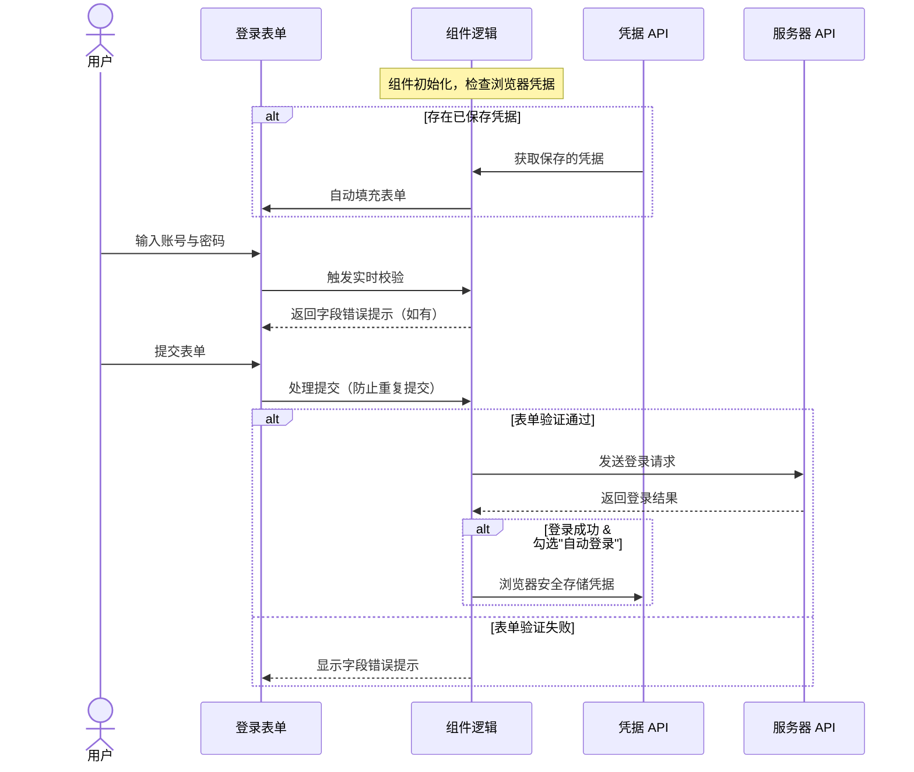

# 用户名/密码登录

用户名/密码登录是**传统的身份验证方式**，为需要明确密码管理的用户提供完整的登录体验，支持邮箱/手机号混输识别、浏览器凭据管理以及无障碍设计。

## 适用群体与场景

### 适用用户群体

- **习惯密码管理**：习惯使用浏览器或第三方密码管理器的用户
- **企业与组织**：有统一密码策略和合规要求的企业环境
- **传统偏好**：更信任或偏好传统密码登录方式的群体

### 特定应用场景

- **多账户切换**：需要频繁切换和管理多个不同账户的环境
- **离线与兼容**：希望在本地保存凭据，或需要兼容不支持新式免密登录的老旧系统

### 推荐使用优先级

1. **首选**：[手机验证码登录](/docs/features/authentication/smscode/)——最便捷安全
2. **次选**：[微信登录](/docs/features/authentication/wechat/)——移动端友好
3. **备选**：用户名/密码登录——传统可靠，作为基础托底方案

## 交互流程



## 代码实现

```tsx
import { useEffect, useState } from 'react';
import { useForm } from 'react-hook-form';
import { zodResolver } from '@hookform/resolvers/zod';
import { z } from 'zod';
import { Eye, EyeOff } from 'lucide-react';

import {
  Form,
  FormControl,
  FormField,
  FormItem,
  FormLabel,
  FormMessage,
} from '@/components/ui/form';
import { Input } from '@/components/ui/input';
import { Button } from '@/components/ui/button';
import { Checkbox } from '@/components/ui/checkbox';

const loginSchema = z.object({
  username: z.string()
    .min(1, { message: '请输入邮箱或手机号' })
    .refine((value) => {
      const isEmail = /^[^\s@]+@[^\s@]+\.[^\s@]+$/.test(value);
      const isPhone = /^1[3-9]\d{9}$/.test(value);
      return isEmail || isPhone;
    }, { message: '请输入有效的邮箱或手机号' }),
  password: z.string()
    .min(6, { message: '密码至少 6 位' })
    .max(32, { message: '密码最多 32 位' }),
  remember: z.boolean().default(false),
});

type LoginFormData = z.infer<typeof loginSchema>;

function LoginForm() {
  const [showPassword, setShowPassword] = useState(false);

  const form = useForm<LoginFormData>({
    resolver: zodResolver(loginSchema),
    defaultValues: {
      username: '',
      password: '',
      remember: false,
    },
    mode: 'onTouched',
  });

  const {
    handleSubmit,
    control,
    setValue,
    formState: { isSubmitting },
  } = form;

  useEffect(() => {
    if ('credentials' in navigator) {
      navigator.credentials.get({ password: true, mediation: 'optional' })
        .then((cred) => {
          if (cred && 'password' in cred) {
            setValue('username', cred.id, { shouldValidate: true });
            setValue('password', cred.password, { shouldValidate: true });
            setValue('remember', true);
          }
        })
        .catch((err) => {
          console.error('自动读取凭据失败:', err);
        });
    }
  }, [setValue]);

  const onSubmit = async (values: LoginFormData) => {
    try {
      const response = await fetch('/api/auth/login', {
        method: 'POST',
        headers: { 'Content-Type': 'application/json' },
        body: JSON.stringify(values),
      });
      if (!response.ok) {
        throw new Error('登录失败');
      }

      if (values.remember && 'credentials' in navigator) {
        const cred = new PasswordCredential({
          id: values.username,
          password: values.password,
        });
        await navigator.credentials.store(cred);
      }
    } catch (error) {
      console.error('登录失败:', error);
    }
  };

  const togglePasswordVisibility = () => {
    setShowPassword((prev) => !prev);
  };

  return (
    <div className="w-full max-w-md p-6 bg-white rounded-lg shadow-md">
      <h2 className="mb-6 text-2xl font-bold text-center">用户登录</h2>

      <Form {...form}>
        <form onSubmit={handleSubmit(onSubmit)} className="space-y-6">
          <FormField
            control={control}
            name="username"
            render={({ field }) => (
              <FormItem>
                <FormLabel>邮箱/手机号</FormLabel>
                <FormControl>
                  <Input
                    type="text"
                    placeholder="请输入邮箱或手机号"
                    inputMode="email"
                    autoComplete="username"
                    autoCapitalize="none"
                    autoCorrect="off"
                    spellCheck={false}
                    required
                    {...field}
                  />
                </FormControl>
                <FormMessage />
              </FormItem>
            )}
          />

          <FormField
            control={control}
            name="password"
            render={({ field }) => (
              <FormItem>
                <div className="flex items-center justify-between">
                  <FormLabel>密码</FormLabel>
                  <a href="/forgot-password" className="text-sm text-blue-600 hover:underline">
                    忘记密码？
                  </a>
                </div>
                <FormControl>
                  <div className="relative">
                    <Input
                      type={showPassword ? 'text' : 'password'}
                      placeholder="请输入密码"
                      autoComplete="current-password"
                      required
                      {...field}
                    />
                    <button
                      type="button"
                      className="absolute inset-y-0 right-0 flex items-center pr-3 text-gray-500 hover:text-gray-700"
                      onClick={togglePasswordVisibility}
                      aria-label={showPassword ? '隐藏密码' : '显示密码'}
                      aria-pressed={showPassword}
                    >
                      {showPassword ? <EyeOff size={16} /> : <Eye size={16} />}
                    </button>
                  </div>
                </FormControl>
                <FormMessage />
              </FormItem>
            )}
          />

          <FormField
            control={control}
            name="remember"
            render={({ field }) => (
              <FormItem className="flex flex-row items-center space-x-2 space-y-0">
                <FormControl>
                  <Checkbox
                    checked={field.value}
                    onCheckedChange={field.onChange}
                  />
                </FormControl>
                <FormLabel className="font-normal cursor-pointer">
                  自动登录
                </FormLabel>
              </FormItem>
            )}
          />

          <Button type="submit" className="w-full" disabled={isSubmitting}>
            {isSubmitting ? '登录中...' : '登录'}
          </Button>

          <div className="text-center text-sm text-gray-500 mt-4">
            还没有账号？{' '}
            <a href="/register" className="text-blue-600 hover:underline">
              立即注册
            </a>
          </div>
        </form>
      </Form>
    </div>
  );
}

export default LoginForm;
```

## 体验与安全特性

该模块在交互、安全和无障碍设计上的处理要点如下：

### 交互与表单校验

- **移动端输入防干扰**：设置 `autoCapitalize="none"`、`autoCorrect="off"` 和 `spellCheck={false}`，避免移动端输入邮箱时首字母自动大写或被自动纠正
- **账号混输识别**：单个输入框支持邮箱与手机号混输，通过正则判断格式并给出对应的错误提示
- **找回路径**：表单内嵌“忘记密码”和“立即注册”入口，密码验证失败时提供找回路径
- **校验时机**：采用 `onTouched` 模式，字段首次失焦后触发校验，避免打断输入
- **密码可见性切换**：支持明文/密文切换，通过 `aria-pressed` 反映切换状态

### 凭据管理与安全 (Credential API)

- **密码管理器兼容**：设置 `autoComplete="username"` 与 `autoComplete="current-password"`，并添加 `required` 属性，便于浏览器识别并提示保存/自动填充
- **凭据存储**：基于 Credential Management API（需 HTTPS），勾选自动登录后将凭据交由浏览器管理
- **防重复提交**：登录按钮在请求期间处于 `disabled` 状态，避免重复提交

### 无障碍与移动端优化 (a11y)

- **移动端键盘**：用户名输入框通过 `inputMode="email"` 唤起对应的虚拟键盘
- **屏幕阅读器**：密码可见性切换按钮通过 `aria-label`、`aria-pressed` 标记当前状态
- **键盘操作**：交互元素（包括密码可见性切换按钮）均可通过 Tab 聚焦、回车触发

## 参考资料

- [有关登录表单的最佳做法](https://web.dev/articles/sign-in-form-best-practices?hl=zh-cn)
- [`autocomplete`](https://developer.mozilla.org/zh-CN/docs/Web/HTML/Reference/Attributes/autocomplete)
- [`autocapitalize`](https://developer.mozilla.org/zh-CN/docs/Web/HTML/Reference/Global_attributes/autocapitalize)
- [`autocorrect`](https://developer.mozilla.org/zh-CN/docs/Web/HTML/Reference/Global_attributes/autocorrect)
- [`inputmode`](https://developer.mozilla.org/en-US/docs/Web/HTML/Reference/Global_attributes/inputmode)
- [`required`](https://developer.mozilla.org/zh-CN/docs/Web/HTML/Reference/Attributes/required)
- [`spellcheck`](https://developer.mozilla.org/zh-CN/docs/Web/HTML/Reference/Global_attributes/spellcheck)
- [`aria-label`](https://developer.mozilla.org/zh-CN/docs/Web/Accessibility/ARIA/Reference/Attributes/aria-label)
- [`aria-pressed`](https://developer.mozilla.org/en-US/docs/Web/Accessibility/ARIA/Reference/Attributes/aria-pressed)
