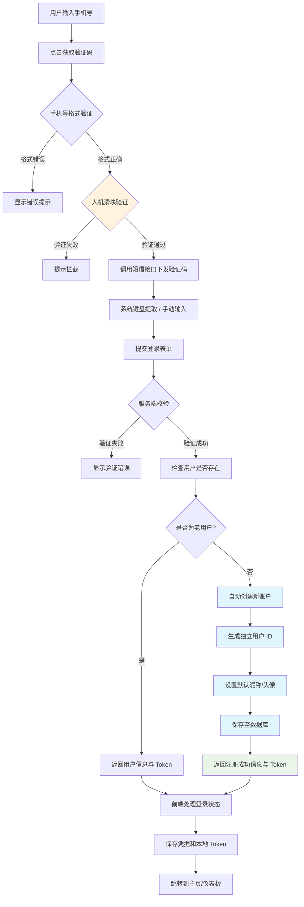

# 手机验证码登录

手机验证码登录无需记忆密码，推荐作为首选登录方式，适合移动端场景。

## 核心功能

- **手机号验证**：前端正则校验与后端严格验证
- **验证码状态管理**：发送节流与 60 秒倒计时防刷
- **多场景复用**：支持注册、登录、找回密码等业务链路
- **自动注册**：首次登录自动创建账户，无需单独的注册流程
- **验证码自动填充**：基于 `autoComplete="one-time-code"` 的系统键盘提取，海外业务可选用 WebOTP API 实现自动读取

## 为什么选择手机验证码登录？

### 用户体验优势

- **零记忆负担**：无需记忆密码
- **登录注册合一**：首次登录即自动注册，一步完成
- **使用门槛低**：适用于各类用户

### 安全性保障

- **时效与单次有效**：验证码有效期通常为 5 分钟，验证成功后立即失效
- **实名溯源**：基于国内手机号实名制的身份验证
- **防暴力破解**：配合人机验证与请求频率限制防御撞库攻击

## 交互流程

验证码登录的核心交互逻辑与时序如下。

### 业务流程图



## 代码实现

基于 React Hook Form 与 Zod 的表单实现。

:::tip
代码中的 `listenForWebOTP` 逻辑针对海外业务，国内环境主要依赖 `autoComplete="one-time-code"` 属性生效，纯国内业务可移除该部分。
:::

```tsx
import { useEffect, useRef, useState, useCallback } from 'react';
import { useForm } from 'react-hook-form';
import { zodResolver } from '@hookform/resolvers/zod';
import { z } from 'zod';
import { toast } from 'sonner';
import { Button } from '@/components/ui/button';
import { Checkbox } from '@/components/ui/checkbox';
import { Input } from '@/components/ui/input';
import {
  Form,
  FormControl,
  FormField,
  FormItem,
  FormLabel,
  FormMessage,
} from '@/components/ui/form';

const COUNTDOWN_SECONDS = 60;
const MOCK_API_DELAY = 800;
const REDIRECT_DELAY = 1000;
const PHONE_REGEX = /^1[3-9]\d{9}$/;

const smsLoginSchema = z.object({
  phone: z
    .string()
    .min(1, { message: '请输入手机号' })
    .regex(PHONE_REGEX, { message: '请输入有效的 11 位手机号' }),
  code: z
    .string()
    .min(1, { message: '请输入验证码' })
    .length(6, { message: '验证码必须为 6 位数字' }),
  remember: z.boolean().optional().default(false),
});

type SmsLoginData = z.infer<typeof smsLoginSchema>;

function SmsLoginForm() {
  const [countdown, setCountdown] = useState(0);
  const [codeStatus, setCodeStatus] = useState<'idle' | 'sending' | 'sent'>('idle');

  const acRef = useRef<AbortController | null>(null);

  const form = useForm<SmsLoginData>({
    resolver: zodResolver(smsLoginSchema),
    defaultValues: { phone: '', code: '', remember: false },
    mode: 'onChange',
  });

  useEffect(() => {
    if ('credentials' in navigator) {
      navigator.credentials.get({ password: true, mediation: 'optional' })
        .then((cred) => {
          if (cred && 'id' in cred && PHONE_REGEX.test(cred.id)) {
            form.setValue('phone', cred.id, { shouldValidate: true });
            form.setValue('remember', true);
          }
        })
        .catch((err) => console.warn('获取凭据失败:', err));
    }
  }, [form]);

  useEffect(() => {
    return () => {
      acRef.current?.abort();
    };
  }, []);

  useEffect(() => {
    if (countdown <= 0) return;
    const timer = setTimeout(() => {
      setCountdown((prev) => prev - 1);
    }, 1000);
    return () => clearTimeout(timer);
  }, [countdown]);

  const listenForWebOTP = useCallback(() => {
    if ('OTPCredential' in window) {
      acRef.current = new AbortController();
      navigator.credentials.get({
        otp: { transport: ['sms'] },
        signal: acRef.current.signal,
      } as CredentialRequestOptions)
        .then((otp: any) => {
          if (otp && otp.code) {
            form.setValue('code', otp.code, { shouldValidate: true });
          }
        })
        .catch((err) => {
          if (err.name !== 'AbortError') console.warn('WebOTP error:', err);
        });
    }
  }, [form]);

  const sendVerificationCode = async () => {
    if (countdown > 0) return;

    const isPhoneValid = await form.trigger('phone');
    if (!isPhoneValid) return;

    setCodeStatus('sending');
    const currentPhone = form.getValues('phone');

    try {
      await new Promise((resolve) => setTimeout(resolve, MOCK_API_DELAY));

      setCodeStatus('sent');
      setCountdown(COUNTDOWN_SECONDS);

      toast.success('验证码已发送', {
        description: `验证码已发送至 ${currentPhone.slice(0, 3)}****${currentPhone.slice(-4)}，请注意查收。`,
      });

      form.setFocus('code');
      listenForWebOTP();
      
    } catch (error) {
      console.error('发送验证码失败:', error);
      setCodeStatus('idle');
      toast.error('发送失败', {
        description: '无法发送验证码，请稍后重试。',
      });
    }
  };

  const onSubmit = async (values: SmsLoginData) => {
    if (acRef.current) acRef.current.abort();

    try {
      const { phone, code, remember } = values;
      
      const result = { success: true, isNewUser: false, token: 'mock-token', nickname: '用户123' };

      if (result.success) {
        if (remember && 'credentials' in navigator) {
          try {
            const cred = new PasswordCredential({
              id: phone,
              password: 'sms-auth-placeholder',
              name: result.isNewUser ? `新用户-${phone.slice(-4)}` : result.nickname,
            });
            await navigator.credentials.store(cred);
          } catch (err) {
            console.warn('凭据 API 存储失败:', err);
          }
        }

        localStorage.setItem('auth_token', result.token);

        toast.success(result.isNewUser ? '注册并登录成功' : '登录成功', {
          description: '正在跳转...',
        });

        setTimeout(() => {
          const redirectUrl = new URLSearchParams(window.location.search).get('redirect') || '/dashboard';
          window.location.href = redirectUrl;
        }, REDIRECT_DELAY);
      } else {
        throw new Error('登录失败，请检查验证码');
      }
    } catch (error) {
      form.setError('code', { type: 'manual', message: (error as Error).message });
    }
  };

  const renderButtonText = () => {
    if (countdown > 0) return `${countdown}s 后重发`;
    return codeStatus === 'sending' ? '发送中...' : '获取验证码';
  };

  const sanitizeToDigits = (value: string) => value.replace(/[^\d]/g, '');

  return (
    <div className="w-full max-w-md p-6 space-y-6 bg-white rounded-xl shadow-sm border">
      <div className="space-y-2 text-center">
        <h2 className="text-2xl font-semibold tracking-tight">欢迎登录</h2>
        <p className="text-sm text-muted-foreground">未注册的手机号验证后将自动注册</p>
      </div>

      <Form {...form}>
        <form onSubmit={form.handleSubmit(onSubmit)} className="space-y-6">
          <FormField
            control={form.control}
            name="phone"
            render={({ field }) => (
              <FormItem>
                <FormLabel>手机号码</FormLabel>
                <FormControl>
                  <Input
                    type="tel"
                    placeholder="请输入 11 位手机号码"
                    autoComplete="username" 
                    maxLength={11}
                    {...field}
                    onChange={(e) => field.onChange(sanitizeToDigits(e.target.value))}
                  />
                </FormControl>
                <FormMessage />
              </FormItem>
            )}
          />

          <FormField
            control={form.control}
            name="code"
            render={({ field }) => (
              <FormItem>
                <FormLabel>验证码</FormLabel>
                <div className="flex gap-3">
                  <FormControl>
                    <Input
                      type="text"
                      inputMode="numeric"
                      autoComplete="one-time-code"
                      placeholder="6位数字"
                      maxLength={6}
                      className="flex-1"
                      {...field}
                      onChange={(e) => field.onChange(sanitizeToDigits(e.target.value))}
                    />
                  </FormControl>
                  <Button
                    type="button"
                    variant="outline"
                    className="w-28"
                    onClick={sendVerificationCode}
                    disabled={countdown > 0 || codeStatus === 'sending'}
                  >
                    {renderButtonText()}
                  </Button>
                </div>
                <FormMessage />
              </FormItem>
            )}
          />

          <FormField
            control={form.control}
            name="remember"
            render={({ field }) => (
              <FormItem className="flex flex-row items-start space-x-3 space-y-0 rounded-md py-2">
                <FormControl>
                  <Checkbox checked={field.value} onCheckedChange={field.onChange} />
                </FormControl>
                <div className="space-y-1 leading-none">
                  <FormLabel className="text-sm font-normal text-muted-foreground cursor-pointer">
                    记住本设备，下次自动登录
                  </FormLabel>
                </div>
              </FormItem>
            )}
          />

          <Button type="submit" className="w-full" disabled={form.formState.isSubmitting}>
            {form.formState.isSubmitting ? '验证中...' : '立即登录'}
          </Button>
        </form>
      </Form>

      <div className="text-center text-xs text-muted-foreground">
        登录即表示已阅读并同意 <a href="/terms" className="underline hover:text-primary">服务条款</a> 与 <a href="/privacy" className="underline hover:text-primary">隐私政策</a>
      </div>
    </div>
  );
}

export default SmsLoginForm;
```

## 短信文案规范

短信文案格式决定系统能否精准提取验证码，需根据目标用户群体选择合适的文案规范：

### 场景一：国内常规业务

国内短信受工信部及运营商防诈骗网关监管，短信中不应包含非备案的域名、链接或特殊符号（如 `@`），否则容易被拦截。

前端配置 `autoComplete="one-time-code"` 后，国内主流手机（iOS Safari、vivo、小米等）的系统键盘可自动识别验证码短信并提供填充建议。

国内标准模板参考：

```text
【产品签名】登录验证码是：123456，5分钟内有效。请勿泄露给他人。
```

### 场景二：海外业务（WebOTP 规范）

面向海外用户且希望利用 Android / Chrome 的 WebOTP API 实现自动读取时，短信必须包含特定的域绑定格式。

海外 WebOTP 模板规范：

```text
Your verification code is: 123456.

@yourdomain.com #123456
```

> **注意**：`@` 后面必须是应用的准确域名，`#` 后面紧跟验证码，且必须放在短信的最末尾。

## 用户体验设计原则

### 无缝注册体验

- **入口合一**：登录与注册共用同一入口，无需单独的注册流程
- **渐进式完善**：自动创建账户不阻塞核心流程，进入 Dashboard 后再引导完善头像、昵称等资料

### 无感式登录

- **Credential Management API**：下次访问时可通过浏览器的凭据选择器直接选取已保存的手机号发起登录
- **基于 autoComplete 的短信提取**：`autoComplete="one-time-code"` 配合 `inputMode="numeric"`，可触发 iOS 及多数国内 Android 系统的验证码键盘提示，兼容性好
- **WebOTP API（海外）**：支持 GMS 的 Android 设备配合特定的短信文案格式，可实现程序级自动读取与填充

## 实施注意事项与最佳实践

:::warning
**防范短信被刷**是上线前的重点检查项，验证码接口容易遭受黑产恶意请求（俗称"短信轰炸机"）。
:::

### 多重防刷策略

- **前端拦截**：强制加入滑块验证、拼图验证或 reCAPTCHA 等人机验证机制，只有人机验证通过才能调用发送验证码 API
- **服务端频控**：限制同一手机号（例如：1分钟1次，1天最多10次）以及同一 IP（例如：1小时最多发送50次）的下发频率

### 状态有效期与长度

- 短信验证码建议使用纯数字 6 位，有效期设置为 5-10 分钟
- 服务端校验验证码时，须保证验证码"阅后即焚"（验证成功后立即使其失效，防止重放攻击）

### 资源回收

若启用 WebOTP API 监听，需通过 `AbortController` 绑定组件生命周期：用户手动输入提交或组件卸载时及时 `.abort()`，避免监听在后台驻留

## 参考资料

- [有关短信动态密码表单的最佳做法](https://web.dev/articles/sms-otp-form?hl=zh-cn)
- [WebOTP API](https://developer.mozilla.org/en-US/docs/Web/API/WebOTP_API)