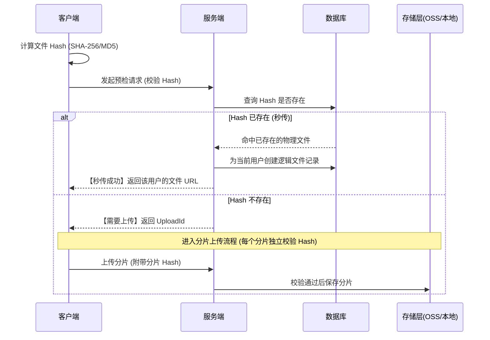
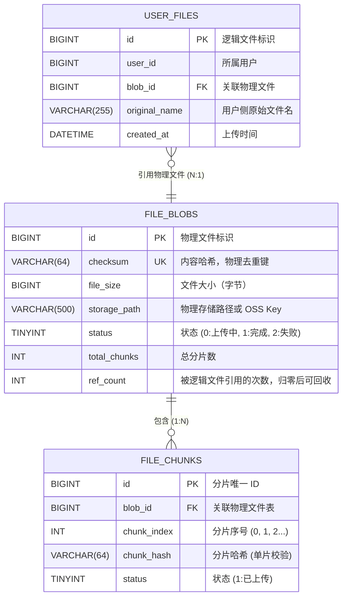
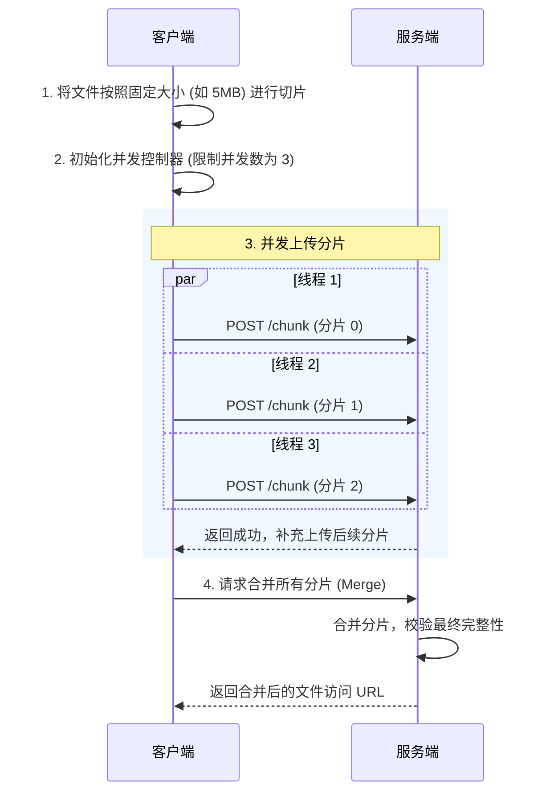
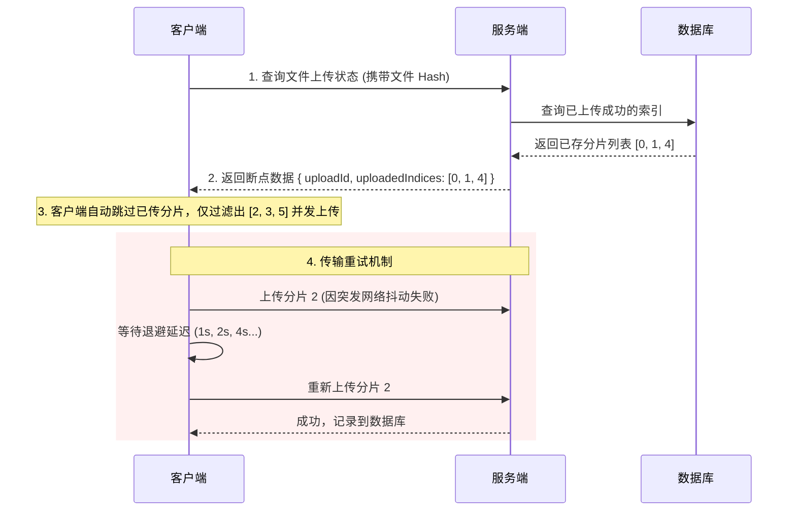

# 文件上传

文件上传是现代 Web 应用的基础设施。方案围绕性能、可靠性与安全性，引入 **哈希校验（秒传）**、**分片并发上传**、**断点续传** 与 **多层安全防护**，并对接对象存储（OSS / MinIO）实现前端直传。

## 核心能力

- **秒传与去重：** 基于文件哈希的文件级秒传与内容去重。
- **分片并发与断点续传：** 分片并发传输，网络中断后仅重传未成功的分片。
- **多层安全防护：** 前端预检、文件魔数校验与 STS 临时凭证直传。
- **对象存储直传：** 对接公有云 OSS 或私有化 MinIO，减少后端带宽压力。

## 1. 核心架构与校验机制 (Checksum)

通过计算文件（及分片）的 SHA-256 或 MD5 哈希值，实现文件完整性校验和“秒传”功能。

### 1.1 上传校验与秒传时序



秒传只复用物理存储，服务端仍为当前用户创建独立的逻辑文件记录，文件访问权限按用户校验——仅知晓哈希不能获得他人文件。对安全敏感场景，整文件哈希应使用 SHA-256；有更高要求时可增加持有证明（Proof of Possession）：服务端随机指定文件某个偏移区段，客户端须返回该区段内容才算秒传成功，证明确实持有该文件。

### 1.2 数据库模型设计

断点续传与秒传要求服务端掌握每个分片的上传状态。模型上区分**物理文件**与**逻辑文件**：`FILE_BLOBS` 以 checksum 为唯一键做内容去重（秒传只复用物理文件）；`USER_FILES` 按用户记录归属与原始文件名，多个用户上传相同内容时各自拥有独立的逻辑记录，指向同一物理文件，权限互相隔离。



### 1.3 基于 Checksum 的物理存储路径设计

物理存储采用基于 Checksum 的内容寻址存储（Content-Addressable Storage），每个哈希仅落盘一份，用户侧的文件名由逻辑表维护：

```
/uploads/
├── e3b0c44298fc1c14.../  (以文件 Hash 命名的目录)
│   └── blob              # 物理文件仅保留一份
├── 9f8e7d6c5b4a3b21.../
│   └── blob
└── ...
```

## 2. 分片并发上传与断点续传

针对大文件，客户端将其切割为多个 Chunk 并发上传，结合服务端的进度记录，网络中断后仅重传未成功的分片。

### 2.1 分片并发上传

客户端通过 `File.slice()` 切割文件，使用 [p-limit](https://github.com/sindresorhus/p-limit)（`pnpm add p-limit`）控制同时在途的分片数量；首个分片失败时通过 `AbortController` 立即中止其余在途与排队中的分片。



#### 核心代码实现

```ts
import pLimit from 'p-limit';

export interface ChunkUploaderOptions {
  chunkSize?: number;
  concurrency?: number;
  onProgress?: (uploadedCount: number, totalChunks: number) => void;
}

export interface ChunkTask {
  chunkBlob: Blob;
  index: number;
}

// 上传错误：携带 HTTP 状态码，网络层错误无 status
export class UploadError extends Error {
  readonly status?: number;

  constructor(message: string, status?: number) {
    super(message);
    this.status = status;
  }

  // 仅网络错误与 5xx 值得重试，4xx 重试也不会成功
  get retryable(): boolean {
    return this.status === undefined || this.status >= 500;
  }
}

export class ChunkUploader {
  protected file: File;

  protected chunkSize: number;

  protected maxConcurrency: number;

  protected chunks: Blob[];

  protected onProgress?: ChunkUploaderOptions['onProgress'];

  constructor(file: File, options: ChunkUploaderOptions = {}) {
    this.file = file;
    this.chunkSize = options.chunkSize ?? 5 * 1024 * 1024; // 分片 5MB
    this.maxConcurrency = options.concurrency ?? 3;
    this.onProgress = options.onProgress;
    this.chunks = this.createChunks();
  }

  protected createChunks(): Blob[] {
    const chunks: Blob[] = [];
    let start = 0;
    while (start < this.file.size) {
      chunks.push(this.file.slice(start, start + this.chunkSize));
      start += this.chunkSize;
    }
    return chunks;
  }

  // 分片哈希，服务端逐片校验传输完整性
  protected async computeChunkHash(chunkBlob: Blob): Promise<string> {
    const digest = await crypto.subtle.digest('SHA-256', await chunkBlob.arrayBuffer());
    return Array.from(new Uint8Array(digest))
      .map((byte) => byte.toString(16).padStart(2, '0'))
      .join('');
  }

  // 并发调度：p-limit 控制并发，任一分片失败即中止其余请求
  public async uploadChunks(
    uploadId: string,
    uploadedIndices: ReadonlySet<number> = new Set(),
    signal?: AbortSignal,
  ): Promise<void> {
    const tasks: ChunkTask[] = this.chunks
      .map((chunkBlob, index) => ({ chunkBlob, index }))
      .filter((task) => !uploadedIndices.has(task.index));

    const totalChunks = this.chunks.length;
    let uploadedCount = uploadedIndices.size;

    const controller = new AbortController();
    const abortOnExternal = () => controller.abort();
    signal?.addEventListener('abort', abortOnExternal);

    const limit = pLimit(this.maxConcurrency);

    try {
      await Promise.all(
        tasks.map((task) =>
          limit(() => {
            if (controller.signal.aborted) return;

            return this.uploadSingleChunk(
              uploadId,
              task.index,
              task.chunkBlob,
              controller.signal,
            ).then(
              () => {
                uploadedCount += 1;
                this.onProgress?.(uploadedCount, totalChunks);
              },
              (error) => {
                controller.abort();
                throw error;
              },
            );
          }),
        ),
      );
    } finally {
      signal?.removeEventListener('abort', abortOnExternal);
    }
  }

  // 单分片上传：FormData 附带分片哈希供服务端校验
  protected async uploadSingleChunk(
    uploadId: string,
    index: number,
    chunkBlob: Blob,
    signal?: AbortSignal,
  ): Promise<void> {
    const formData = new FormData();
    formData.append('chunk', chunkBlob);
    formData.append('uploadId', uploadId);
    formData.append('index', String(index));
    formData.append('chunkHash', await this.computeChunkHash(chunkBlob));

    let response: Response;
    try {
      response = await fetch('/api/upload/chunk', {
        method: 'POST',
        body: formData,
        signal,
      });
    } catch (error) {
      // 主动取消原样透传，其余视为网络层错误（无 status，可重试）
      if (error instanceof DOMException && error.name === 'AbortError') throw error;
      throw new UploadError(`分片 ${index} 网络请求失败`);
    }

    if (!response.ok) {
      throw new UploadError(
        `分片 ${index} 上传失败，接口返回 ${response.status}`,
        response.status,
      );
    }
  }
}

export default ChunkUploader;
```

`onProgress(uploadedCount, totalChunks)` 回调供 UI 层渲染进度条；`uploadChunks` 与 `startUpload` 均接受外部 `AbortSignal`，组件卸载或用户取消时调用 `controller.abort()` 即可中断整个上传流程。

### 2.2 断点续传与网络重试

发生中断或页面刷新后，客户端以文件哈希查询服务端已上传的分片列表定位断点，仅重传缺失分片。单分片失败时仅对网络错误与 5xx 做指数退避重试，4xx 业务错误直接向上抛出。文件哈希由前端预先计算，大文件建议使用 SparkMD5 等增量算法，避免整文件读入内存。



#### 核心代码实现

```ts
import ChunkUploader, { type ChunkUploaderOptions, UploadError } from './ChunkUploader';

export interface ResumableUploaderOptions extends ChunkUploaderOptions {
  retries?: number;
  baseDelay?: number;
}

export interface StatusResponse {
  uploadId: string;
  uploadedIndices: number[];
}

class ResumableUploader extends ChunkUploader {
  private maxRetries: number;

  private baseDelay: number;

  constructor(file: File, options: ResumableUploaderOptions = {}) {
    super(file, options);
    this.maxRetries = options.retries ?? 3; // 单分片最大重试次数
    this.baseDelay = options.baseDelay ?? 1000; // 退避基础延迟 1s
  }

  // 重写单分片上传：仅对可重试错误做指数退避 + 随机抖动
  protected override async uploadSingleChunk(
    uploadId: string,
    index: number,
    chunkBlob: Blob,
    signal?: AbortSignal,
    retryCount = 0,
  ): Promise<void> {
    try {
      await super.uploadSingleChunk(uploadId, index, chunkBlob, signal);
    } catch (error) {
      const isAbort = error instanceof DOMException && error.name === 'AbortError';
      // 主动取消与 4xx 业务错误不重试
      if (isAbort || !(error instanceof UploadError) || !error.retryable) {
        throw error;
      }
      if (retryCount >= this.maxRetries) {
        throw new Error(`分片 ${index} 重试 ${this.maxRetries} 次后仍失败`, {
          cause: error,
        });
      }

      const jitter = Math.floor(Math.random() * 500);
      const delay = 2 ** retryCount * this.baseDelay + jitter;
      await new Promise((resolve) => setTimeout(resolve, delay));

      return this.uploadSingleChunk(uploadId, index, chunkBlob, signal, retryCount + 1);
    }
  }

  // 断点续传主流程：fileHash 由前端预先计算
  public async startUpload(fileHash: string, signal?: AbortSignal): Promise<string> {
    // 以文件哈希查询断点
    const statusRes = await fetch(`/api/upload/status?hash=${fileHash}`, { signal });
    if (!statusRes.ok) {
      throw new UploadError(`状态接口返回 ${statusRes.status}`, statusRes.status);
    }
    const { uploadId, uploadedIndices } = (await statusRes.json()) as StatusResponse;

    // 跳过已上传分片，调度剩余分片并发上传
    await this.uploadChunks(uploadId, new Set(uploadedIndices), signal);

    // 通知服务端合并，并附带文件哈希做最终完整性校验
    const mergeRes = await fetch('/api/upload/merge', {
      method: 'POST',
      headers: { 'Content-Type': 'application/json' },
      body: JSON.stringify({ uploadId, fileName: this.file.name, checksum: fileHash }),
      signal,
    });
    if (!mergeRes.ok) {
      throw new UploadError(`合并接口返回 ${mergeRes.status}`, mergeRes.status);
    }

    const { url } = (await mergeRes.json()) as { url: string };
    return url;
  }
}

export default ResumableUploader;
```

## 3. 安全防护体系

文件上传是 Web 安全的高风险业务，服务端需要纵深防护：

1. **三层校验：** 
   - **前端预检：** 文件扩展名及 `accept` 属性校验，拦截明显的误选。 
   - **MIME 类型校验：** 检查 HTTP 报文中的 `Content-Type`（客户端可伪造，仅作初筛）。 
   - **文件魔数校验 (Magic Number)：** 服务端读取文件头前几位字节判定真实类型。
     ```ts
     // Node.js 读取文件头前 4 字节判定真实类型
     import { open } from 'node:fs/promises';

     const handle = await open(filePath, 'r');
     const buffer = Buffer.alloc(4);
     await handle.read(buffer, 0, 4, 0);
     await handle.close();

     const hex = buffer.toString('hex');
     // JPG 为 ffd8ff，PNG 为 89504e47
     ```
2. **重命名混淆：** 使用哈希值或 UUID 重新命名落盘目录与文件名，避免路径遍历攻击 (`../../`)。
3. **取消执行权限：** 物理存储目录仅授予读写权限，取消执行权限，防止 WebShell 被意外执行。

## 4. 存储引擎选型

生产环境建议将存储与应用服务器解耦，采用对象存储服务，并配合**客户端直传模式**降低后端 I/O 压力。

### 4.1 方案对比

| 存储引擎 | 适用场景 | 优势 |
|---|---|---|
| **阿里云 OSS** / **腾讯云 COS** 等 | 公有云业务、高并发互联网产品 | 弹性扩容、免运维；内置 CDN 加速与图像/视频处理能力 |
| **MinIO** | 私有云部署、内网隔离、信创及合规业务 | 开源且兼容 AWS S3 API；适合内网与本地化部署环境 |

### 4.2 前端直传方案实现 (以阿里云 OSS 为例)

由服务端签发 STS 临时凭证，前端使用 OSS SDK 将文件分片直传至云端存储。

#### Node.js 服务端签发 STS Token

```ts
import Core from '@alicloud/pop-core';

export interface STSCredentials {
  AccessKeyId: string;
  AccessKeySecret: string;
  SecurityToken: string;
  Expiration: string;
}

export async function generateUploadToken(userId: string): Promise<STSCredentials> {
  const client = new Core({
    accessKeyId: process.env.RAM_AK as string,
    accessKeySecret: process.env.RAM_SK as string,
    endpoint: 'https://sts.aliyuncs.com',
    apiVersion: '2015-04-01',
  });

  // 限定凭证仅能写入该用户目录；PutObject 覆盖分片写操作，AbortMultipartUpload 用于中断残留分片
  const policy = {
    Version: '1',
    Statement: [
      {
        Effect: 'Allow',
        Action: ['oss:PutObject', 'oss:AbortMultipartUpload'],
        Resource: [`acs:oss:*:*:your-bucket/uploads/${userId}/*`],
      },
    ],
  };

  const res = await client.request('AssumeRole', {
    RoleArn: process.env.ROLE_ARN,
    RoleSessionName: `session_${userId}`,
    Policy: JSON.stringify(policy),
    DurationSeconds: 3600, // 凭证1小时有效
  }, { method: 'POST' });

  return (res as { Credentials: STSCredentials }).Credentials;
}
```

#### 前端 SDK 直传与断点续传

```ts
import OSS from 'ali-oss';

export interface STSConfig {
  AccessKeyId: string;
  AccessKeySecret: string;
  SecurityToken: string;
}

export async function uploadToOSS(
  file: File,
  stsConfig: STSConfig,
  userId: string,
): Promise<string> {
  const client = new OSS({
    region: 'oss-cn-hangzhou',
    accessKeyId: stsConfig.AccessKeyId,
    accessKeySecret: stsConfig.AccessKeySecret,
    stsToken: stsConfig.SecurityToken,
    bucket: 'your-bucket',
  });

  const objectKey = `uploads/${userId}/${Date.now()}_${file.name}`;
  const checkpointKey = `oss_upload_${file.name}_${file.size}`;
  const checkpointStr = localStorage.getItem(checkpointKey);
  const checkpoint = checkpointStr ? JSON.parse(checkpointStr) : undefined;

  // 失败时保留 checkpoint 供下次续传；错误向上抛出，由调用方决定提示方式
  await client.multipartUpload(objectKey, file, {
    parallel: 3, // 并发分片数
    partSize: 5 * 1024 * 1024, // 分片 5MB
    checkpoint, // 传入断点，跳过已上传分片
    progress: (_p: number, cpt: any) => {
      localStorage.setItem(checkpointKey, JSON.stringify(cpt)); // 记录断点
    },
  });

  localStorage.removeItem(checkpointKey);
  // 返回 objectKey，访问地址由业务侧拼接 CDN 域名生成
  return objectKey;
}
```