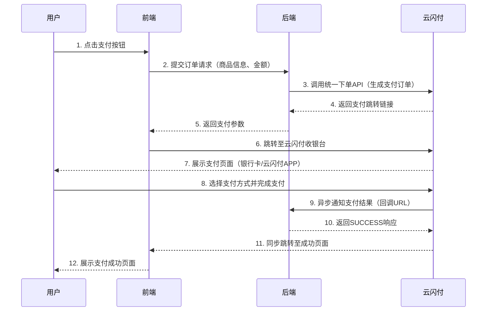

import Tabs from '@theme/Tabs';
import TabItem from '@theme/TabItem';

# 云闪付

## 简介

云闪付是中国银联推出的移动支付APP，也是银联推广的非接触式支付产品的统一品牌。银联在线支付为商户提供统一的支付接口，支持各大银行的借记卡和信用卡支付。本文档主要介绍银联网关支付的接入流程和代码实现。

银联网关支付是用户在商户网站选择银联支付后，跳转到银联收银台，选择相应的银行卡完成支付。支持各大银行的借记卡、信用卡，以及云闪付APP等多种支付方式。

## 参考资料

- [中国银联开放平台](https://open.unionpay.com/)
- [全渠道产品技术文档](https://open.unionpay.com/tjweb/acproduct/list?apiservId=448)
- [网关支付产品介绍](https://open.unionpay.com/tjweb/acproduct/APIList?acpAPIId=754&apiservId=448&version=V2.2)
- [银联SDK下载](https://open.unionpay.com/tjweb/support/faq/mchlist?faqId=3384)

## 支付流程



## 关键代码实现

### 前端调用（JavaScript）

```javascript
// 银联未提供前端 JSAPI，支付通过页面跳转或表单提交到银联收银台完成

async function createUnionpayOrder(orderData) {
  const response = await fetch('/api/unionpay/create-order', {
    method: 'POST',
    headers: { 'Content-Type': 'application/json' },
    body: JSON.stringify(orderData)
  });

  const result = await response.json();

  if (result.payUrl) {
    window.location.href = result.payUrl;
    return;
  }

  submitUnionpayForm(result.formHtml);
}

// 后端返回自动提交表单时，注入页面并提交（避免 innerHTML += 覆盖已有 DOM）
function submitUnionpayForm(formHtml) {
  const container = document.createElement('div');
  container.innerHTML = formHtml;
  document.body.appendChild(container);
  container.querySelector('form')?.submit();
}

// 前台回跳（frontUrl）为银联向商户后端的表单 POST，由后端验签后
// 302 至前端结果页并携带订单号；前端仅凭订单号查询后端获取最终状态，
// 不信任 URL 携带的 respCode（客户端参数可被篡改）
async function checkPaymentResult(orderId) {
  const response = await fetch(`/api/unionpay/query-order?orderId=${orderId}`);
  const result = await response.json();

  if (result.respCode === '00') {
    window.location.href = '/pay/success';
  }
}
```

### 后端实现

<Tabs>
<TabItem value="java" label="Java" default>

```java
// 使用银联官方SDK（acpservice-sdk）
import java.time.LocalDateTime;
import java.time.format.DateTimeFormatter;
import java.util.HashMap;
import java.util.Map;

import com.unionpay.acp.sdk.AcpService;
import com.unionpay.acp.sdk.SDKConfig;

public class UnionpayService {

  private final String merId;

  // 银联交易时间格式
  private static final DateTimeFormatter TXN_TIME_FORMATTER =
      DateTimeFormatter.ofPattern("yyyyMMddHHmmss");

  public UnionpayService(String merId) {
    this.merId = merId;
    // 读取 classpath 下的 acp_sdk.properties（证书与网关地址配置）
    SDKConfig.getConfig().loadPropertiesFromSrc();
  }
  
  // 创建支付订单：返回自动提交表单的 HTML
  public String createPayOrder(OrderData orderData) {
    Map<String, String> requestData = new HashMap<>();
    
    requestData.put("version", "5.1.0");
    requestData.put("encoding", "UTF-8");
    requestData.put("signMethod", "01");
    requestData.put("txnType", "01");          // 01：消费
    requestData.put("txnSubType", "01");       // 01：自助消费
    requestData.put("bizType", "000201");      // 000201：B2C 网关支付
    requestData.put("channelType", "08");      // 08：手机渠道
    requestData.put("accessType", "0");        // 0：商户直接入
    requestData.put("currencyCode", "156");    // 人民币
    
    requestData.put("merId", merId);
    requestData.put("orderId", orderData.getOrderId());
    requestData.put("txnTime", getCurrentTime());
    requestData.put("txnAmt", String.valueOf(orderData.getTxnAmt())); // 单位：分
    requestData.put("orderDesc", orderData.getOrderDesc());
    
    requestData.put("frontUrl", orderData.getFrontUrl());
    requestData.put("backUrl", orderData.getBackUrl());
    
    // 报文签名
    Map<String, String> signedData = AcpService.sign(requestData, "UTF-8");
    
    String requestFrontUrl = SDKConfig.getConfig().getFrontRequestUrl();
    return AcpService.createAutoFormHtml(requestFrontUrl, signedData, "UTF-8");
  }
  
  // 验证签名
  public boolean verifySignature(Map<String, String> respParam) {
    return AcpService.validate(respParam, "UTF-8");
  }
  
  // 查询订单
  public Map<String, String> queryOrder(String orderId, String txnTime) {
    Map<String, String> requestData = new HashMap<>();
    
    requestData.put("version", "5.1.0");
    requestData.put("encoding", "UTF-8");
    requestData.put("signMethod", "01");
    requestData.put("txnType", "00");          // 00：查询
    requestData.put("txnSubType", "00");
    requestData.put("bizType", "000201");
    requestData.put("accessType", "0");
    
    requestData.put("orderId", orderId);
    requestData.put("merId", merId);
    requestData.put("txnTime", txnTime);
    
    Map<String, String> signedData = AcpService.sign(requestData, "UTF-8");
    String requestUrl = SDKConfig.getConfig().getSingleQueryUrl();
    Map<String, String> rspData = AcpService.post(signedData, requestUrl, "UTF-8");
    
    // 应答验签，防篡改
    if (!AcpService.validate(rspData, "UTF-8")) {
      throw new IllegalStateException("查询应答验签失败");
    }
    if (!"00".equals(rspData.get("respCode"))) {
      throw new IllegalStateException("订单查询失败: " + rspData.get("respMsg"));
    }
    
    return rspData;
  }
  
  private String getCurrentTime() {
    return TXN_TIME_FORMATTER.format(LocalDateTime.now());
  }
}
```

</TabItem>
</Tabs>

### 配置文件

银联 SDK 通过 `SDKConfig.loadPropertiesFromSrc()` 读取 classpath 下的 `acp_sdk.properties`：

```properties
# 交易网关地址
acp_sdk.frontTransUrl=https://gateway.95516.com/gateway/api/frontTransReq.do
acp_sdk.backTransUrl=https://gateway.95516.com/gateway/api/backTransReq.do
acp_sdk.singleQueryUrl=https://gateway.95516.com/gateway/api/singleQuery.do

# 签名证书（PKCS12 格式及密码）
acp_sdk.signCert.path=/certs/production_sign_cert.pfx
acp_sdk.signCert.pwd=your_cert_password
acp_sdk.signCert.type=PKCS12

# 验签用的银联根证书 / 中级证书 / 加密证书
acp_sdk.rootCert.path=/certs/root_cert.cer
acp_sdk.middleCert.path=/certs/middle_cert.cer
acp_sdk.encryptCert.path=/certs/production_encrypt_cert.cer
acp_sdk.validateCert.dir=/certs/

acp_sdk.version=5.1.0
acp_sdk.signMethod=01
```

商户号 `merId`、前台回跳 `frontUrl` 与后台通知 `backUrl` 属于业务参数，随每笔交易请求传入。
