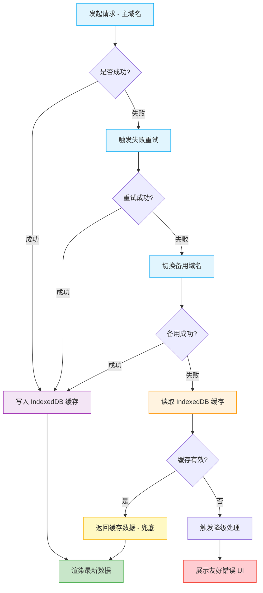

# 接口请求兜底容灾

基于 IndexedDB 的前端接口请求容灾方案，提供多层级容错机制，在极端网络或服务异常情况下保持核心页面可用。

## 核心特性

- **四级递进容灾：** 主域名 -> 重试 -> 备用域名 -> 本地缓存 -> 平滑降级
- **避免白屏：** 接口异常时优先展示本地缓存数据
- **无感存取：** 成功请求自动持久化至 IndexedDB，无需手动干预
- **来源可判断：** 结合 isFetching 与 navigator.onLine 区分实时数据与离线缓存

## 容灾策略架构

GET 请求按以下流程流转：



## 实际工程落地指南

生产环境推荐使用 **TanStack Query + Axios + localforage** 组合实现。

### 核心依赖安装

```bash
pnpm add @tanstack/react-query @tanstack/react-query-devtools @tanstack/react-query-persist-client @tanstack/query-async-storage-persister axios localforage
```

### Axios 层面：定制 Orval Mutator 实现主/备域名容灾

在 Orval 自定义 Mutator `src/api/mutator/axios.ts` 中加入备用域名重试策略：

```ts
import Axios from 'axios';
import type { AxiosError, AxiosRequestConfig } from 'axios';
import { toast } from 'sonner';

// 统一错误响应结构
export interface ApiErrorResponse {
  code: string;
  message: string;
  error: string;
}

const PRIMARY_DOMAIN = import.meta.env.VITE_API_BASE_URL || '/api';
const BACKUP_DOMAINS = [
  'https://backup1.example.com',
  'https://backup2.example.com',
];

export const axiosInstance = Axios.create({
  baseURL: PRIMARY_DOMAIN,
  timeout: 5000,
});

// 请求拦截器：自动携带 Token
axiosInstance.interceptors.request.use(
  (config) => {
    const token = localStorage.getItem('token');
    if (token) {
      config.headers.Authorization = `Bearer ${token}`;
    }
    return config;
  },
  (error) => Promise.reject(error),
);

// 扩展 AxiosRequestConfig 以支持容灾参数
interface FallbackRequestConfig extends AxiosRequestConfig {
  fallbackEnabled?: boolean;
  fallbackDomains?: string[];
  _retryCount?: number;
}

// 响应拦截器：GET 失败时依次切换备用域名，全部失效后进入全局错误处理
axiosInstance.interceptors.response.use(
  (response) => response,
  async (error: AxiosError<ApiErrorResponse>) => {
    const config = error.config as FallbackRequestConfig;

    // 1. 备用域名切换：仅网络错误与 5xx 值得重试，4xx 换域名也不会成功
    const isRetryable = !error.response || error.response.status >= 500;

    if (
      config &&
      config.fallbackEnabled &&
      config.method === 'get' &&
      isRetryable
    ) {
      config._retryCount = config._retryCount || 0;
      const fallbackDomains = config.fallbackDomains || BACKUP_DOMAINS;

      if (config._retryCount < fallbackDomains.length) {
        const nextDomain = fallbackDomains[config._retryCount];
        config._retryCount += 1;
        config.baseURL = nextDomain;

        return axiosInstance(config);
      }
    }

    // 2. 全局错误拦截（容灾失效或未开启容灾的请求）
    if (error.response) {
      const { status, data } = error.response;
      switch (status) {
        case 401:
          localStorage.removeItem('token');
          window.location.href = `/login?redirect=${encodeURIComponent(
            window.location.pathname,
          )}`;
          break;
        case 403:
          toast.error('访问被拒绝', {
            description: data.message || '没有操作权限',
          });
          break;
        case 500:
          toast.error('服务器内部错误', {
            description: data.error || '系统异常',
          });
          break;
        default:
          break;
      }
    }
    return Promise.reject(error);
  },
);

// Orval 自定义请求函数
export const axios = <T>(
  config: AxiosRequestConfig,
  options?: FallbackRequestConfig,
): Promise<T> =>
  axiosInstance({
    ...config,
    ...options,
  }).then(({ data }) => data);

export type ErrorType<Error = ApiErrorResponse> = AxiosError<Error>;
export type BodyType<BodyData> = BodyData;
```

### TanStack Query 层面：利用全局 Provider 开启 IndexedDB 兜底

在 `src/providers/QueryProvider.tsx` 中配置持久化存储：

```tsx
import { QueryClient } from '@tanstack/react-query';
import { ReactQueryDevtools } from '@tanstack/react-query-devtools';
import { PersistQueryClientProvider } from '@tanstack/react-query-persist-client';
import { createAsyncStoragePersister } from '@tanstack/query-async-storage-persister';
import localforage from 'localforage';
import type { ReactNode } from 'react';

// IndexedDB 存储实例
const idbStorage = localforage.createInstance({
  name: 'AppFallbackDB',
  storeName: 'api_cache',
});

const asyncStoragePersister = createAsyncStoragePersister({
  storage: idbStorage,
});

const queryClient = new QueryClient({
  defaultOptions: {
    queries: {
      retry: 2, // 网络级重试，与 axios 层备用域名形成两级容灾
      retryDelay: (attemptIndex) => Math.min(1000 * 2 ** attemptIndex, 10000),
      staleTime: 5 * 60 * 1000, // 数据 5 分钟内视为新鲜
      gcTime: 24 * 60 * 60 * 1000, // 缓存保留 24 小时，作为断网兜底池
      refetchOnWindowFocus: false,
    },
  },
});

interface QueryProviderProps {
  children: ReactNode;
}

// PersistQueryClientProvider 会在缓存恢复完成后再渲染子组件，避免首屏闪烁
function QueryProvider({ children }: QueryProviderProps) {
  return (
    <PersistQueryClientProvider
      client={queryClient}
      persistOptions={{
        persister: asyncStoragePersister,
        maxAge: 24 * 60 * 60 * 1000,
      }}
    >
      {children}
      <ReactQueryDevtools initialIsOpen={false} />
    </PersistQueryClientProvider>
  );
}

export default QueryProvider;
```

### 组件级使用：结合 Orval 生成的 Hooks 处理降级

业务代码正常调用 Orval 生成的 hooks，通过 `axios` 选项传递请求级配置开启容灾。断网或服务器崩溃时，UI 自动展示 IndexedDB 中的旧数据：

```tsx
import { AlertCircle } from 'lucide-react';
import { useGetUserById } from '@/api/user/user';
import { Skeleton } from '@/components/ui/skeleton';
import { Card, CardContent, CardHeader, CardTitle } from '@/components/ui/card';
import { Alert, AlertDescription, AlertTitle } from '@/components/ui/alert';

interface UserDetailProps {
  userId: string;
}

function UserDetail({ userId }: UserDetailProps) {
  // 通过 axios 选项向 mutator 传递容灾开关
  const { data: user, isLoading, error, isFetching } = useGetUserById(userId, {
    axios: { fallbackEnabled: true },
  });

  if (isLoading) {
    return (
      <div className="space-y-4">
        <Skeleton className="h-8 w-52" />
        <Skeleton className="h-24 w-full rounded-xl" />
      </div>
    );
  }

  // 所有域名失效且缓存为空时才渲染错误；存在旧缓存时带着缓存继续渲染
  if (error && !user) {
    const apiCode = error.response?.data?.code;
    return (
      <Alert variant="destructive">
        <AlertCircle className="h-4 w-4" />
        <AlertTitle>加载失败</AlertTitle>
        <AlertDescription>
          {apiCode === 'A0201'
            ? '账户异常，用户不存在'
            : error.response?.data?.message || error.message}
        </AlertDescription>
      </Alert>
    );
  }

  return (
    <div className="space-y-4">
      {/* 离线时提示当前展示的是缓存数据 */}
      {!isFetching && !navigator.onLine && (
        <Alert>
          <AlertTitle>当前处于离线状态</AlertTitle>
          <AlertDescription>网络不可用，正在展示离线缓存数据</AlertDescription>
        </Alert>
      )}

      <Card>
        <CardHeader>
          <CardTitle>用户信息</CardTitle>
        </CardHeader>
        <CardContent>
          <p className="text-sm text-muted-foreground">姓名：{user?.name}</p>
        </CardContent>
      </Card>
    </div>
  );
}

export default UserDetail;
```

## 静态资源容灾

接口容灾只能保证“数据可达”，一旦 CDN 上的 JS/CSS/图片加载失败，页面依然会白屏或样式丢失。静态资源的重试与域名降级通过构建插件 [@rsbuild/plugin-assets-retry](https://github.com/rstackjs/rsbuild-plugin-assets-retry) 实现：构建时向 HTML 与 Rspack Runtime 注入一段运行时代码，监听资源加载错误事件，失败后自动重建标签重试，并按配置依次切换备用 CDN 域名，与接口侧的“主域名 -> 备用域名”策略形成完整的容灾闭环。

```ts
// rsbuild.config.ts
// pnpm add @rsbuild/plugin-assets-retry -D
import { pluginAssetsRetry } from '@rsbuild/plugin-assets-retry';

export default defineConfig({
  plugins: [
    pluginAssetsRetry({
      // 仅处理 CDN 资源
      test: /cdn\.example\.com/,
      // 第一个为默认域名，其余为备用域名，失败时依次降级
      domain: ['cdn1.example.com', 'cdn2.example.com'],
      // 单个资源最大重试次数
      max: 3,
      // 重试延迟，按重试次数递增
      delay: (times) => times * 1000,
      // 重试时追加 query，避免浏览器/CDN 缓存干扰重试结果
      addQuery: true,
      // 全部失败后的兜底回调，用于监控上报
      // 注意：回调会被序列化内联进 HTML，只能使用函数内部自包含的逻辑
      onFail: ({ url, tagName }) => {
        navigator.sendBeacon('/api/monitor/asset-error', JSON.stringify({ url, tagName }));
      },
    }),
  ],
  output: {
    assetPrefix: 'https://cdn1.example.com',
  },
});
```

配合 `rules` 选项可为不同类型资源配置差异化策略，例如核心 JS 多次重试、图片快速放弃：

```ts
pluginAssetsRetry({
  rules: [
    { type: ['script'], max: 5, delay: 1000 },
    { test: /\.css$/, max: 2, delay: 500 },
    { test: /\.(png|jpe?g|gif|svg|webp|avif)$/, max: 1 },
  ],
});
```

限制与注意：

- **仅重试 async/defer 脚本：** 同步 `<script src>` 重试无法保证执行顺序，插件不做处理。
- **避免敏感信息与外部引用：** 配置会被序列化注入 HTML，`onRetry`/`onSuccess`/`onFail` 中不应放入 Token，也不应引用函数外部的变量或方法。
- **运行时代码保持内联：** 保持 `inlineScript: true`（默认）。抽成独立文件后，该文件自身加载失败会导致重试机制整体失效。
- **Module Federation 场景：** 远程模块的静态资源重试需使用 [@module-federation/retry-plugin](https://www.npmjs.com/package/@module-federation/retry-plugin)。

## 典型应用场景

- **电商平台：** 主服务器故障或大促限流时，优先展示 IndexedDB 中缓存的商品列表，避免空白页面。
- **内容/资讯平台：** 网络不稳定时仍可阅读之前缓存的文章列表，保证内容可用。
- **企业级 SaaS：** 权限或配置接口异常时，用缓存的基础权限维持核心流程运转，同时上报异常。

## 最佳实践与限制

- **仅限 GET 请求：** 兜底缓存仅适用于无副作用的 GET 请求，不对 POST/PUT/DELETE 等写操作使用缓存兜底。
- **区分容灾层级：** Axios 层的备用域名覆盖“服务器宕机但网络通畅”的情况；TanStack Query 层的 IndexedDB 覆盖“断网或所有服务器不可用”的情况。
- **离线检测的局限：** `navigator.onLine` 存在误报场景，仅作为 UI 提示参考，可靠的兜底依赖持久化缓存与请求失败结果本身。
- **数据敏感性与清理：** 包含金融/医疗等高敏数据时，缓存至 IndexedDB 前应加密（如 `crypto-js`），并在用户登出时调用 `queryClient.clear()` 与 `idbStorage.clear()` 清理本地数据。