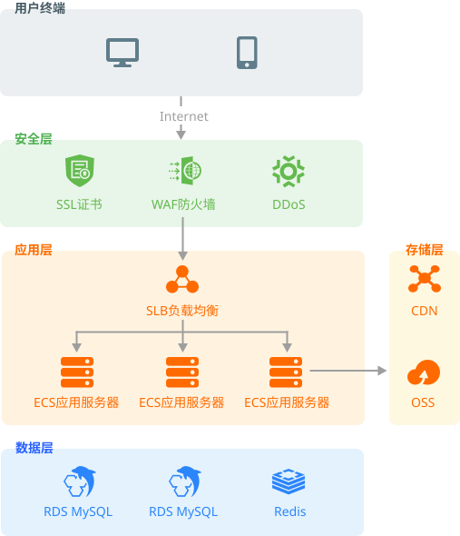

# 部署

## 项目构建和环境部署

构建和部署统一在 **GitLab CI** 中完成，不依赖本地环境。这样每次发版跑的都是同一套流程，避免"我本地是好的"这类问题。

### 构建和部署流程

主要依赖下面两个镜像：

- [Node.js](https://nodejs.org/)：用于安装依赖、构建和启动
- [nginx](https://nginx.org/)：作为 HTTP 服务器，或者充当反向代理

:::tip
- [nginx 配置](/docs/reference/configuration/#nginx)
- [Docker 配置](/docs/reference/configuration/#docker)
:::

| 镜像      | 步骤                                                                         | React/Vue | Next.js |
|---------|----------------------------------------------------------------------------|-----------|---------|
| Node.js | 执行 `pnpm install --frozen-lockfile` 安装依赖                                  | ✔️        | ✔️      |
|         | 执行 `pnpm run build` 构建项目                                                    | ✔️        | ✔️      |
|         | 构建完成后生成 `/dist` 目录                                                         | ✔️        |         |
|         | 将静态资源文件上传至 CDN/OSS 存储                                                      | ✔️        | ✔️      |
|         | 执行 `pnpm run start` 启动 Node.js 服务                                           |           | ✔️      |
| nginx   | 编译 [Brotli nginx 模块](https://github.com/google/ngx_brotli)                 | ✔️        | ✔️      |
|         | 编译 [ModSecurity nginx 模块](https://github.com/SpiderLabs/ModSecurity-nginx) | ✔️        | ✔️      |
|         | 将编译完成后模块复制到 nginx 的模块目录                                                    | ✔️        | ✔️      |
|         | 复制 `/dist` 目录到 nginx 的服务器目录                                                | ✔️        |         |
|         | 复制 `nginx.conf` 文件替换镜像的 nginx 配置文件                                         | ✔️        | ✔️      |
|         | 更新 nginx 配置以使用 CDN/OSS 域名作为静态资源引用                                          | ✔️        | ✔️      |
|         | 执行 `nginx -s reload` 重新加载 nginx 配置                                         | ✔️        | ✔️      |
|         | 启动 nginx                                                                   | ✔️        | ✔️      |

:::info
- Nginx 镜像基于 Alpine，构建镜像时编译了 `ngx_brotli`（更高压缩率）和 ModSecurity（配合 OWASP CRS 规则集）两个模块，镜像体积小，同时具备压缩和 WAF 防御能力，具体见 [nginx 配置](/docs/reference/configuration/#nginx)。
- CI 会把构建出的静态资源同步到 OSS（作为 CDN 回源站），但会排除 `index.html` 和 `service-worker.js`。这两个文件始终由 Nginx 容器直接返回——入口文件一旦被 CDN 缓存住，发版后用户拿到的可能还是旧页面。
:::

:::warning
- 安装依赖和构建项目都在 GitLab CI 中执行，不需要写进 Dockerfile
- Dockerfile 只需要配置 nginx 相关的步骤
  - 如果需要用 Node.js 启动服务（如 Next.js），则要在 Dockerfile 中配置 Node.js 相关步骤并运行 Node.js 服务，此时用 `docker-compose` 启动，nginx 做反向代理
:::

### 前端构建优化

打包阶段由构建工具自动完成以下优化：

1. **资源体积与图片**
   - 构建时压缩项目内的静态资源（SVG 优化、去除图片冗余元数据等）
   - 自动生成 WebP、AVIF 等现代格式，改善 LCP
   - 配置 Code Splitting 和 Tree Shaking，移除无效代码
2. **预压缩与 PWA**
   - 生产构建直接产出最高级别的 `.br`（Brotli）和 `.gz` 预压缩文件，省去服务器动态压缩的 CPU 开销
   - 集成 Service Worker，提供本地缓存和离线访问（单文件最大缓存 5MB）
3. **安全**
   - 构建时为静态资源生成 SRI（Subresource Integrity）哈希，防止 CDN 资源被篡改
   - 为资源添加 `crossorigin='anonymous'` 属性，规范跨域行为

## 高级发布策略

直接覆盖旧版本的部署方式有风险：新版本一旦有问题，所有用户同时受影响。好在构建产物带内容哈希、入口文件又在 Nginx 容器里，蓝绿部署和灰度发布做起来都不复杂。

### 蓝绿部署

构建产物带内容哈希，新版本资源传到 OSS 后旧版本不会被覆盖，新旧版本可以同时在线。切换时只需要通过容器编排工具（如 Kubernetes 或 Docker Swarm）把网关流量指向新版本的 Nginx 容器——`index.html` 本来就在容器里，换掉容器就完成了切换。

对用户来说整个过程是无感的：旧页面引用的旧哈希资源依然在 OSS 上，不会出现发布期间请求不到资源导致 404 的问题。

### 金丝雀发布 (Canary Release)

先让一小部分用户用上新版本，观察没有问题再逐步扩大范围：

- 通过特性开关（Feature Flags）控制放量节奏，例如 5% → 20% → 100%
- 灰度期间关注 CI 的性能趋势报告和核心转化数据，有异常就先暂停放量
- 用 Cookie 或 LocalStorage 记住用户所在的分组，保证同一个用户在灰度期间一直看到同一个版本

## 线上验证与应急回滚

发布策略可以按业务选，但两件事不能省：上线后的验证，和出问题时的回滚。

### 部署上线验证

部署完成后，先花几分钟过一遍这些点：

1. 应用本身：健康检查端点（如 `/health`、`/api/health`）返回 200；手动走一遍核心路由；打开控制台，确认没有预期外的报错
2. 静态资源：检查响应头，确认 `content-encoding: br` 或 `gzip` 生效；确认页面图片是构建产出的 WebP / AVIF 格式
3. 安全与性能：确认静态资源请求带上了 `crossorigin` 和 `integrity`（SRI）；看一眼 CI 里最新一次 Lighthouse 报告，和上个版本相比没有明显退步

### 紧急回滚预案

出现以下情况时不要犹豫，直接回滚：

- 核心性能指标突然明显劣化
- 生产环境的 E2E 巡检连续失败告警
- 大量用户反馈问题，或 ModSecurity 误拦截明显增多

回滚操作：

1. 把网关指向的 Nginx 镜像 Tag 回退到上一个稳定版本（如 `latest-stable`），恢复旧版 `index.html`。OSS 上保留了历史版本的哈希资源，旧页面引用的文件依然能正常访问，所以回滚只需要换容器
2. 调用 CDN API 刷新 `index.html` 和 `service-worker.js` 的边缘缓存

回滚之后还要留意 Service Worker：它的缓存留在用户浏览器里，不会随服务端回滚消失。如果旧缓存把用户锁在坏版本上，可以在新版 `index.html` 里加一段兜底逻辑——注销当前注册的 SW 并强制刷新页面。

## 服务器架构推荐

服务器产品推荐使用[阿里云](https://cn.aliyun.com/)产品

### 安全层

- [SSL 证书](https://www.aliyun.com/product/cas)：启用 HTTPS
- [DDoS 防护](https://www.aliyun.com/product/security/ddos)：应对 DDoS 攻击
- [Web 应用防火墙 WAF](https://www.aliyun.com/product/waf)：拦截恶意请求，保护服务器

:::info
Nginx 容器已经集成了 ModSecurity 和 OWASP CRS 规则集（见上文），接入层本身就具备 WAF 能力，云 WAF 按需搭配使用即可。
:::

### 应用层

- [负载均衡 SLB](https://www.aliyun.com/product/slb)：把流量分发到多台云服务器，避免单点故障
- [云服务器 ECS](https://www.aliyun.com/product/ecs)：部署 HTTP 服务器和项目代码
  - CPU 内存比 1:2，建议 4vCPU / 8GB 起步，CPU 推荐 AMD EPYC 系列
  - 带宽建议 5MB 以上
  - 建议支持 IPv6
  - 操作系统推荐 [Ubuntu Server](https://ubuntu.com/server)、[Rocky Linux](https://rockylinux.org/) 或 [AlmaLinux](https://almalinux.org/)

### 存储层

- [CDN](https://www.aliyun.com/product/cdn)：把静态资源分发到离用户更近的节点，加快访问速度
  - 缓存策略配合内容哈希：带哈希的文件设置长缓存
  - 启用 HTTP/2 和 HTTP/3（QUIC）
  - 配置合适的 CORS 策略
  - 启用 Brotli 压缩
  - 可选：自动 WebP/AVIF 转换
- [对象存储 OSS](https://www.aliyun.com/product/oss)：存放构建产物和历史版本资源
  - 配置生命周期策略，定期清理过旧的资源版本
  - 利用存储类型（标准、低频、归档）降低成本
  - 作为 CDN 的回源使用

### 数据层

数据层不是前端关注的重点，这里不展开。
