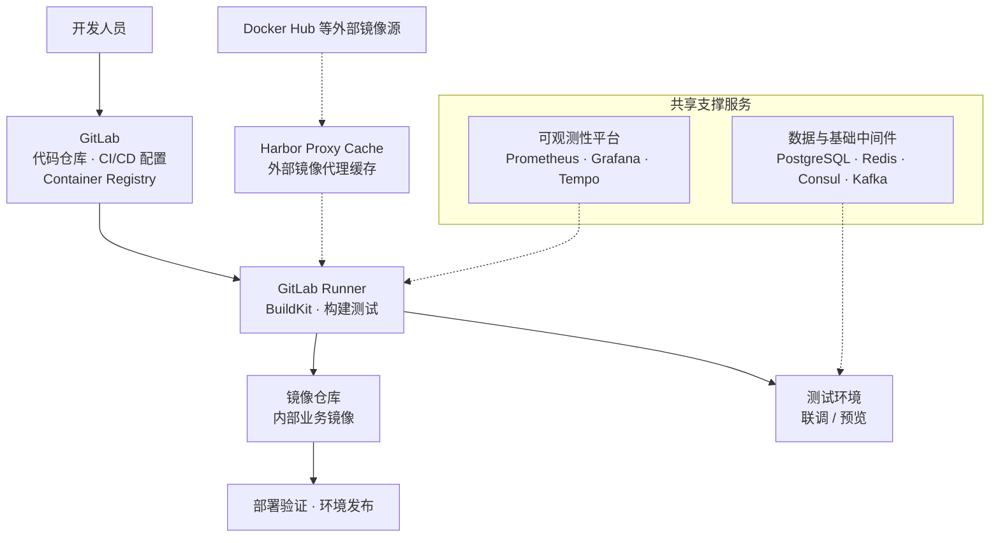

# 开发基础设施

开发基础设施是支撑日常研发、持续集成、自动化测试和故障排查的基础平台。对于同时使用 Java、Go、Python、Node.js 的全栈研发团队，它不应只是“一台 GitLab 加一个 Runner”，而是一套相互协作的内部 DevOps 环境。

先澄清一个常见误区：多语言技术栈本身不会让服务器需求成倍增长，真正决定资源规模的是 **CI 并行构建量、运行中的服务实例数量、数据规模和监控保留周期**。

本方案面向约 10 人研发团队，以虚拟机和 Docker 为基础，规划遵循以下原则：

- **职责分离**：代码托管、CI 构建、集成测试、数据服务和可观测性分层管理
- **资源隔离**：避免构建高峰拖慢数据库、中间件和监控系统
- **按需拆分**：初期允许轻量服务共用虚拟机，负载增长后逐步拆分
- **安全优先**：非受信任的 CI 任务不得访问生产凭证
- **可恢复**：关键代码、配置和数据具备备份与恢复方案

本章聚焦研发团队内部基础设施。线上生产架构与发布策略参见[部署](/docs/pipeline/deploy/)，流水线配置参见[CI/CD](/docs/pipeline/ci/)，应用与用户侧监控参见[监控](/docs/pipeline/monitor/)。

## 一、总体架构

整个开发基础设施划分为研发交付、集成测试、共享服务和可观测性四个部分：

GitLab 负责代码托管与流水线编排，Runner 执行实际构建与测试，测试服务器提供持续运行的联调和预览环境，共享中间件提供基础数据服务，可观测性平台收集和展示运行状态。Harbor Proxy Cache 作为独立的镜像代理缓存，减少对 Docker Hub 等上游仓库的直接依赖。

## 二、服务器规划与资源配置

建议 **6 台虚拟机作为初始基线**。以下均为起步规格而非固定容量，应根据 CI 并发量、镜像大小和数据保留周期调整。

| 服务器 | 部署组件 | CPU / 内存 | 磁盘 | 主要职责 |
| --- | --- | --- | --- | --- |
| GitLab 与内部镜像仓库 | GitLab CE/EE、Container Registry | 8 vCPU / 16 GB | 系统盘 100 GB + 数据盘 300–500 GB SSD | 代码托管、Merge Request、Pipeline 管理、内部业务镜像存储 |
| CI 构建服务器 | GitLab Runner、Docker BuildKit、构建缓存 | 8–16 vCPU / 16–32 GB | 400–500 GB SSD | 多语言构建、测试、镜像构建与安全扫描（初始并发 3–4 个 Job） |
| 集成测试与动态预览服务器 | Nginx、Docker Compose、测试版前后端服务 | 8 vCPU / 16 GB | 300–500 GB SSD | API 联调、集成测试、分支预览、发布前验证 |
| 数据库与基础中间件服务器 | PostgreSQL、Redis、Consul、Kafka | 8–16 vCPU / 32 GB | 500 GB–1 TB SSD/NVMe | 为开发与集成测试环境提供共享数据服务 |
| 可观测性服务器 | Prometheus、Grafana、Tempo、告警组件 | 8 vCPU / 16 GB | 500 GB–1 TB SSD | 基础设施指标、应用指标、链路追踪和告警 |
| Harbor 镜像代理缓存服务器 | Harbor Proxy Cache | 4 vCPU / 8 GB | 500 GB–1 TB SSD | 代理与缓存 Docker Hub 等外部镜像 |

### GitLab 与内部镜像仓库

GitLab 是研发基础设施的核心入口。自带的 Container Registry 足以存放内部构建的业务镜像，不必为了内部镜像存储再单独部署一套仓库。

磁盘容量应考虑仓库历史、Pipeline 产物、镜像层和日志的增长，而不是仅按当前代码仓库大小估算；GitLab 数据与容器镜像数据应区分开，分别规划持久化卷与备份策略。

### CI 构建服务器

CI 构建服务器负责执行多语言项目的依赖安装、编译、测试、镜像构建和安全扫描，是整个方案中最容易出现资源峰值的节点：Java 编译占用内存，前端打包和镜像构建消耗 CPU 与磁盘 I/O，Playwright 等 E2E 测试还会额外占用浏览器进程资源。

因此建议：

- Runner 与 GitLab 控制面分离，避免构建高峰拖慢代码托管和 Pipeline 调度
- 对单个 Job 设置合理的超时和资源限制，并发按实际负载逐步调整
- 使用 BuildKit 和语言包管理器缓存，减少重复下载与构建

具体的流水线阶段与缓存配置参见 [CI/CD](/docs/pipeline/ci/)。

### 集成测试与动态预览服务器

与 CI 上的临时测试任务不同，这台服务器承担相对长期的运行环境：前端预览站点、后端联调服务和测试数据库实例。

动态预览环境按分支或 Merge Request 创建独立部署，分支合并或删除后自动清理对应容器。应建立统一的环境命名、访问地址和过期清理规范，避免长期遗留无人维护的测试服务。

:::danger
测试环境不得默认连接生产数据库。测试凭证、数据和访问权限应与生产环境完全分离。
:::

### 数据库与基础中间件服务器

开发阶段可以将轻量中间件部署在同一台虚拟机上，但应为各服务配置独立数据卷、容器资源限制和容量监控。数据库与消息队列的持久化磁盘尤其需要关注 I/O 表现和剩余空间。

| 组件 | 初期部署策略 | 需要拆分的情况 |
| --- | --- | --- |
| PostgreSQL | 单独规划数据卷，可与其他轻量中间件共机 | 数据量增长、磁盘 I/O 成为瓶颈 |
| Redis | 与基础中间件共机 | 内存占用高、需要独立故障域 |
| Consul | 开发环境允许单节点起步 | 需要生产级高可用时，按正式集群方案部署 |
| Kafka | 轻量开发环境可单节点运行 | 消息积压、持续高吞吐或需要多节点可靠性 |

:::danger
**单节点开发中间件不具备生产级高可用。** 开发环境能在一台机器上正常运行，不代表相同的部署方式适合生产业务。如果中间件负载明显增长，优先拆分 PostgreSQL 和 Kafka，并结合数据重要性评估是否转向托管服务。
:::

### 可观测性服务器

Prometheus 采集与存储指标，Grafana 负责查询和展示，Tempo 存储分布式追踪数据。磁盘容量与指标基数、Trace 采样率和保留时间直接相关，应在上线前设置保留策略和磁盘告警，而不是无限期保留全部数据。

研发基础设施至少应关注：

- Runner 队列长度、任务等待时间和失败率
- GitLab、Registry 与关键服务的可用性
- 测试环境容器健康状态和资源占用
- 数据库连接数、Kafka 积压等共享中间件的关键指标
- Prometheus 与 Tempo 的数据增长和存储容量

### Harbor 镜像代理缓存服务器

Harbor Proxy Cache 解决外部镜像拉取慢、网络不稳定和重复拉取的带宽开销：首次拉取从上游获取镜像，后续请求复用本地缓存。配置方式参见 [Harbor 官方文档](https://goharbor.io/docs/main/administration/configure-proxy-cache/)。

注意区分两类镜像的存放位置：内部业务镜像在 GitLab Container Registry，Docker Hub 等上游镜像的代理缓存在 Harbor，两者职责不同，不应混在一起。基础设施规模较小时可以暂缓部署 Harbor；如果外部镜像拉取经常失败或耗时明显，再优先补齐。

## 三、总体资源预算

| 资源类别 | 规划范围 |
| --- | --- |
| 虚拟机数量 | 6 台 |
| CPU | 44–60 vCPU |
| 内存 | 104–120 GB |
| SSD / NVMe | 约 2.6–4.6 TB |
| 备份空间 | 独立规划，不包含在以上容量中 |

:::tip
预算有限时，可以将集成测试服务器与 Harbor 合并，按 5 台建设。但不建议优先压缩 CI 构建、数据库和可观测性的资源——这三处资源不足会直接拖慢交付效率。
:::

:::warning
不建议为了减少虚拟机数量，把 GitLab、Runner、数据库、Kafka 和监控全部塞进一台服务器。初期部署虽然简单，但构建高峰、数据盘压力或单机故障会影响整个研发平台。
:::

## 四、多语言技术栈与 CI 资源管理

四种语言可以共用一组 Runner，**不需要按编程语言各买构建服务器**。实际资源需求由任务类型、并发量、依赖下载量和测试规模决定。

| 技术栈 | 常见负载 | 优化措施 |
| --- | --- | --- |
| Java | Maven/Gradle 编译、测试 | JDK 构建镜像、依赖缓存、合理的 JVM 内存限制 |
| Go | 多包并行编译、测试 | Go Module 缓存和构建缓存 |
| Python | 依赖安装、原生扩展编译、测试 | 锁文件与 pip/uv 缓存 |
| Node.js | pnpm 安装、TypeScript、打包、单元与 E2E 测试 | 缓存 pnpm store，复用依赖安装产物，限制并发 |

建议通过 Docker Executor 或统一容器化构建环境隔离各语言工具链，构建任务使用明确的基础镜像版本，避免依赖 Runner 宿主机上不受控的全局工具。

CI 扩容应参考实际数据而非开发人员数量，重点观察 Job 排队等待时间、平均耗时与失败率、Runner 资源峰值、缓存命中率和 E2E 测试占用的并发资源。

## 五、网络、安全与权限隔离

开发基础设施虽然是内部平台，但 GitLab、镜像仓库、测试服务器和中间件仍然是重要的安全边界。

**网络访问：**

- 内部服务通过私有网络互通，仅向必要的用户和 Runner 开放端口
- PostgreSQL、Redis、Kafka、Consul 不应直接向公网开放
- 运维 SSH 限制来源地址，优先使用 VPN 或受控运维入口

**凭证管理：**

- 数据库密码、Token、私钥不得提交至 Git 仓库或写入镜像
- CI/CD 使用受保护的变量，开发测试凭证与生产凭证完全独立
- 定期清理过期账号和无用 Token

**Runner 隔离：**

Runner 执行的 Pipeline 脚本可以访问其运行环境授予的资源，不应让任何分支的任意 CI 任务都能读取生产凭证或操作生产服务器。为普通构建与生产部署设置不同的 Runner，涉及生产的 Job 使用保护分支、受保护变量和人工审批机制。

## 六、备份与恢复

基础设施故障不应只靠重启容器解决，关键数据必须有明确的恢复路径：

| 对象 | 维护要求 |
| --- | --- |
| GitLab | 定期备份仓库与配置，验证恢复流程 |
| Container Registry | 备份重要镜像，或确保可从构建产物重新生成 |
| PostgreSQL / Consul | 定期备份数据与配置，保留独立恢复副本 |
| Docker Compose | 配置模板、启动脚本和部署文档纳入版本管理 |

:::danger
备份应与工作负载分开保存，不要只放在原始数据所在的同一块磁盘或同一台虚拟机上。对生产相关配置与数据，应明确 RPO（恢复点目标）和 RTO（恢复时间目标），并定期做恢复演练——没验证过的备份等于没有备份。
:::

## 七、建设顺序与演进规划

建议按依赖关系逐步建设，而不是一次性部署所有组件。

### 第一阶段：建立研发交付链路

1. 部署 GitLab 和内部 Container Registry
2. 部署 GitLab Runner 和 Docker BuildKit
3. 配置多语言构建环境、缓存、自动化测试与镜像扫描
4. 建立测试服务器与基本的部署、清理脚本

完成后，应能从代码提交出发，自动完成检查、测试、构建、镜像发布和开发环境部署。

### 第二阶段：补齐共享基础服务

1. 部署 PostgreSQL、Redis 和 Consul
2. 在有明确消息需求时再部署 Kafka
3. 为不同环境建立独立配置、数据和访问权限

### 第三阶段：建立监控与镜像缓存

1. 部署 Prometheus、Grafana、Tempo 和告警组件
2. 接入 GitLab、Runner、测试环境及共享中间件的监控
3. 根据外部镜像拉取情况决定是否部署 Harbor Proxy Cache
4. 设置镜像清理、日志轮转、磁盘告警与容量阈值

### 第四阶段：自动化与扩容

随着团队、应用和部署频率增长，逐步引入 Terraform / OpenTofu 等基础设施即代码工具、独立的数据库或可观测性节点、更多 Runner 节点，或云托管数据库与容器服务。是否引入新工具，应由明确的运维痛点或容量瓶颈驱动。

## 八、上线前检查清单

- [ ] GitLab、Container Registry 和 Runner 已正常工作
- [ ] 多语言项目能够在 CI 环境中完成构建与测试
- [ ] Runner 并发和资源限制符合当前任务规模
- [ ] 测试环境可以部署、访问和按期清理
- [ ] 共享中间件的访问边界已配置，未直接暴露公网
- [ ] Harbor Proxy Cache（如已启用）可正常访问上游并命中缓存
- [ ] Prometheus、Grafana、Tempo 和告警链路正常
- [ ] 生产凭证与开发测试凭证已隔离
- [ ] GitLab、数据库和重要配置已配置备份，并验证过关键数据的恢复流程
- [ ] 基础设施变更有记录，恢复步骤和维护责任人明确

开发基础设施不是一次性建成的固定系统。初期优先建立稳定、可维护的交付链路；随着负载增长，再逐步拆分资源、自动化基础设施管理并提升可用性。
